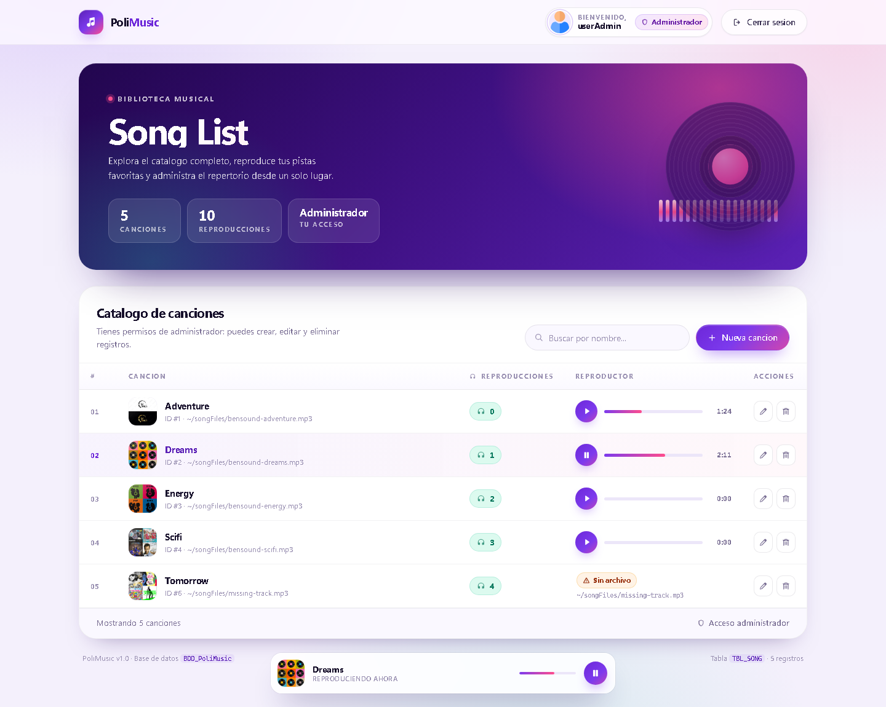
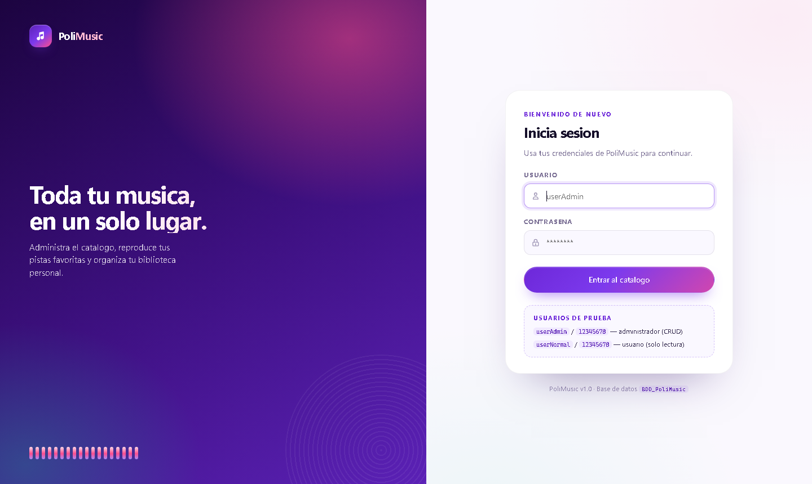
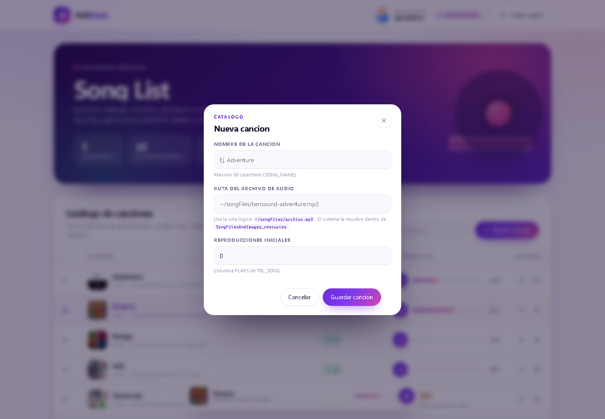
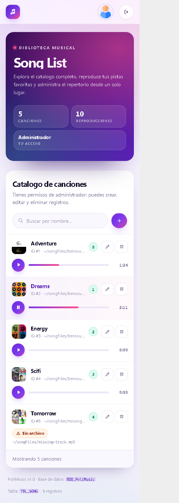

# PoliMusic — Vista *Song List* (ASP clásico + SQL Server)

Vista de listado de canciones del proyecto **PoliMusic**, con reproductor HTML5
integrado, control de sesión y CRUD completo restringido al rol administrador.



---

## 1. Contenido del proyecto

```
webapppolimusicv1_asp/
├── Default.asp                     Redirige a songList.asp
├── login.asp                       Inicio de sesión (crea la sesión)
├── logout.asp                      Cierre de sesión (destruye la sesión)
├── songList.asp                    ★ Vista principal del listado
├── songActions.asp                 API JSON (create / update / delete / play)
├── web.config                      Configuración de IIS (ASP, MIME, documento inicial)
│
├── includes/
│   ├── config.asp                  Constantes: conexión, roles, rutas
│   ├── util.asp                    Helpers: escape HTML/JSON, rutas, formato
│   ├── db.asp                      Conexión ADO + comandos parametrizados
│   └── auth.asp                    Sesión, roles y guardias de acceso
│
├── assets/
│   ├── css/polimusic.css           Diseño completo (paleta, tabla, player, modales)
│   └── js/songlist.js              Reproductor, búsqueda y CRUD vía fetch
│
├── SongFilesAndImages_resources/   Recursos estáticos
│   ├── SongFiles/                  Archivos .mp3
│   ├── UserImages/                 Fotos de usuario
│   └── PlaylistImages/             Portadas
│
├── BDD_PoliMusic.sql               Script de la base de datos
└── docs/screenshots/               Capturas de la interfaz
```

> **Orden de los `#include`**: `config.asp` → `util.asp` → `db.asp` → `auth.asp`.
> `config.asp` debe ir primero porque define las constantes que usan los demás.

---

## 2. Requisitos

| Componente | Detalle |
|---|---|
| Servidor web | IIS con la característica **ASP** (ASP clásico) habilitada |
| Base de datos | SQL Server (LocalDB / Express / Developer) |
| Navegador | Chrome, Edge o Firefox actualizados |

---

## 3. Puesta en marcha

### 3.1 Base de datos

```sql
-- Desde SSMS o sqlcmd
:r BDD_PoliMusic.sql
```

El script crea la base `BDD_PoliMusic`, las tablas y los datos de ejemplo.
Verifica que exista la tabla `TBL_SONG` con sus 5 canciones:

```sql
SELECT ID_SONG, SONG_NAME, SONG_PATH, PLAYS FROM dbo.TBL_SONG;
```

### 3.2 Credenciales

Edita `includes/config.asp`:

```vbscript
Const DB_SERVER   = "localhost"        ' o ".\SQLEXPRESS", "(local)", etc.
Const DB_NAME     = "BDD_PoliMusic"
Const DB_USER     = "sa"
Const DB_PASSWORD = "admin04"
```

`includes/db.asp` prueba automáticamente varias cadenas de conexión
(`MSOLEDBSQL`, `SQLNCLI11`, `SQLOLEDB`, `ODBC Driver 17/18`) y usa la primera
que responda, así que no hace falta cambiar nada más si el proveedor difiere.

### 3.3 Publicar en IIS

**Opción A — Sitio completo**

1. IIS → *Sitios* → **Agregar sitio web**.
2. Ruta física: la carpeta de este proyecto.
3. Puerto: `80` (o `8080` si el 80 está ocupado).
4. Grupo de aplicaciones: **No Managed Code**.

**Opción B — Aplicación dentro de un sitio existente**

Clic derecho sobre *Default Web Site* → **Agregar aplicación** → alias
`polimusic`, ruta física del proyecto, mismo grupo de aplicaciones.

**Habilitar ASP clásico** (una sola vez, si no está activo):

```powershell
# PowerShell como administrador
Enable-WindowsOptionalFeature -Online -FeatureName IIS-ASP -All
```

**Permisos**: el usuario `IIS_IUSRS` necesita *Lectura* sobre la carpeta del
proyecto (incluida `SongFilesAndImages_resources`).

### 3.4 Abrir la aplicación

```
http://localhost/            →  Default.asp  →  songList.asp
http://localhost/login.asp   →  si no hay sesión
```

### 3.5 Usuarios de prueba

| Usuario | Contraseña | USER_TYPE | Acceso |
|---|---|---|---|
| `userAdmin` | `12345678` | 1 | Administrador — CRUD completo |
| `userNormal` | `12345678` | 0 | Usuario — solo lectura y reproducción |

---

## 4. Cómo funciona

### Sesión

`login.asp` es el único punto que escribe la sesión:

```vbscript
Session("ID_USER")    = rs("ID_USER")
Session("USERNAME")   = rs("USERNAME")
Session("USER_TYPE")  = rs("USER_TYPE")   ' 0 = normal | 1 = admin
Session("USER_PHOTO") = rs("USER_PHOTO")
```

`includes/auth.asp` las expone mediante `LoadSessionContext()` y ofrece las
guardias `RequireLogin()`, `RequireAdminJson()` e `IsAdmin()`.

### Roles

| | Usuario (0) | Administrador (1) |
|---|---|---|
| Ver catálogo | ✅ | ✅ |
| Reproducir | ✅ | ✅ |
| Crear / editar / eliminar | ❌ | ✅ |
| Columna **Acciones** | no se renderiza | sí |
| Botón **Nueva canción** | no se renderiza | sí |

El control es doble: la interfaz oculta los elementos y `songActions.asp`
vuelve a validar el rol en el servidor antes de ejecutar cualquier escritura.

### Rutas de audio (`SONG_PATH`)

La base guarda rutas lógicas (`~/songFiles/bensound-adventure.mp3`).
`ResolveResourcePath()` las traduce a la carpeta de recursos:

```
~/songFiles/x.mp3        →  SongFilesAndImages_resources/SongFiles/x.mp3
~/userImages/x.jpg       →  SongFilesAndImages_resources/UserImages/x.jpg
~/playlistImages/x.png   →  SongFilesAndImages_resources/PlaylistImages/x.png
```

Si el archivo no existe en disco, la fila se muestra como **“Sin archivo”** en
lugar de un reproductor roto (`ResourceFileExists()`).

### Reproductor

Cada fila incluye un elemento `<audio>` real. Los controles visibles (play/pausa,
barra de progreso con búsqueda, tiempo) se manejan con la API HTML5 desde
`songlist.js`; al iniciar la reproducción se registra el play
(`PLAYS = PLAYS + 1`) y se actualiza el contador sin recargar la página.

### CRUD

`songActions.asp` responde JSON y recibe `POST` con formulario codificado:

| Acción | Rol | Respuesta |
|---|---|---|
| `create` | admin | `{"ok":true,"data":{"id":6}}` |
| `update` | admin | `{"ok":true,"data":{"id":6}}` |
| `delete` | admin | `{"ok":true,"data":{"id":6}}` |
| `play`   | cualquiera | `{"ok":true,"data":{"id":6,"plays":5}}` |

Todas las consultas usan **parámetros ADO** (`?` + `CreateParameter`), nunca
concatenación de cadenas, para evitar inyección SQL.

Al eliminar una canción se borran primero sus filas en `TBL_TRACKLIST`,
`TBL_PLAYER` y `TBL_PLAYLIST_SONG` (restricciones FK) dentro de una
transacción, de modo que la operación no falla ni deja registros huérfanos.

---

## 5. Personalización

La paleta está centralizada en `:root` al inicio de `assets/css/polimusic.css`:

```css
--violet-600: #6d28d9;   /* color primario  */
--pink:       #ff4d8d;   /* acento          */
--mint:       #0fb98f;   /* contador plays  */
--bg:         #f4f0fc;   /* fondo           */
```

Cambiar esos cuatro valores reestiliza toda la aplicación.

---

## 6. Notas

- **Archivos de audio**: en `BDD_PoliMusic` solo existía
  `bensound-adventure.mp3`. Para que las 5 filas de ejemplo sean reproducibles,
  ese archivo se copió como `bensound-dreams/energy/scifi/tomorrow.mp3`.
  Reemplázalos por los audios reales cuando los tengas.
- **Contraseñas**: los usuarios de ejemplo guardan la contraseña en texto plano,
  tal como viene en el script de la base. Para un entorno real conviene aplicar
  hash (SHA-256 + salt) en `login.asp`.
- **Depuración**: `web.config` tiene `scriptErrorSentToBrowser="true"` para ver
  errores detallados. Desactívalo en producción.

---

## 7. Capturas

| Login | Modal de alta/edición |
|---|---|
|  |  |

| Vista móvil (≤ 780 px) |
|---|
|  |
